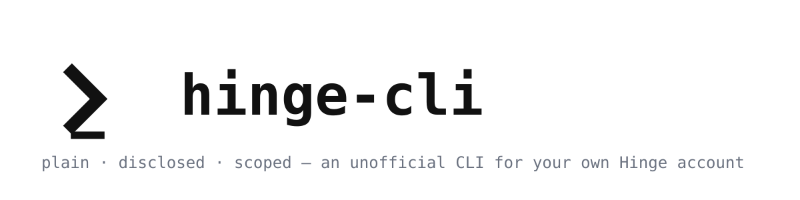

<picture>
  <source media="(prefers-color-scheme: dark)" srcset=".github/assets/banner-dark.svg">
  
</picture>

An unofficial, read-only command-line client for your own Hinge account — the only one that tells
you upfront this almost certainly violates Hinge's Terms of Service, and commits to never
automating a swipe.

[](https://github.com/ifthenelse/hinge-cli/actions/workflows/ci.yml)
[](LICENSE)
[](https://github.com/ifthenelse/hinge-cli/releases)

It talks directly to Hinge's real HTTP API (reverse-engineered from captured app traffic, not UI
automation at runtime) using a session you capture from your own phone, and reports things the app
shows but doesn't let you script: your subscription tier, like/rose limits. Business intent and
non-goals (no bots, no bulk actions, no multi-account) live in [intent.md](intent.md).

| | |
| --- | --- |
| Owner | Andrea Collet |
| Support | GitHub issues on this repository (single-maintainer project — see CONTRIBUTING.md) |


## Features

- **Read your account** — subscription tier and remaining like/rose limits, from the terminal.
- **Bring your own session** — no reimplementation of Hinge's phone+SMS/App Attest login; you
  capture a session from your own logged-in app and import it.
- **No server, no third party** — a single local binary calls Hinge's API directly; nothing is
  proxied through infrastructure this project runs.
- **Manual only, by design** — every action is one explicit command for your own account; no
  auto-swipe, no bulk messaging, no multi-account support, and none planned (see
  [intent.md](intent.md#non-goals)).

## Install

### Download the latest version

| OS | Download |
| --- | --- |
| Windows (x86_64) | [hinge-x86_64-pc-windows-msvc.zip](https://github.com/ifthenelse/hinge-cli/releases/latest/download/hinge-x86_64-pc-windows-msvc.zip) |
| macOS, Apple silicon | [hinge-aarch64-apple-darwin.tar.gz](https://github.com/ifthenelse/hinge-cli/releases/latest/download/hinge-aarch64-apple-darwin.tar.gz) |
| macOS, Intel | [hinge-x86_64-apple-darwin.tar.gz](https://github.com/ifthenelse/hinge-cli/releases/latest/download/hinge-x86_64-apple-darwin.tar.gz) |
| Linux (x86_64) | [hinge-x86_64-unknown-linux-gnu.tar.gz](https://github.com/ifthenelse/hinge-cli/releases/latest/download/hinge-x86_64-unknown-linux-gnu.tar.gz) |

Unpack it and put `hinge` (`hinge.exe` on Windows) somewhere on your `PATH`. The macOS and Windows
binaries are unsigned, so your OS may ask you to confirm the first run. All versions and release
notes: [Releases](https://github.com/ifthenelse/hinge-cli/releases).

### Other ways to install

With [Rust](https://rustup.rs) installed (see requirements below):

```sh
cargo install --git https://github.com/ifthenelse/hinge-cli     # latest main, no clone needed
```

```sh
git clone https://github.com/ifthenelse/hinge-cli.git
cd hinge-cli
cargo build --release   # binary: target/release/hinge
cargo install --path .  # optional: puts `hinge` on your PATH
```

Use the source routes for platforms without a prebuilt binary (Linux or Windows on ARM, older Linux
distributions). The project is not published on crates.io.

### Requirements

**Software**
- Windows 10 or newer, macOS 11 or newer, or Linux with a recent glibc (the Linux binary is built on
  Ubuntu 24.04; on older distributions build from source).
- Windows only: the [Microsoft Visual C++ Redistributable](https://learn.microsoft.com/cpp/windows/latest-supported-vs-redistributable-packages)
  (already present on most systems).
- Building from source: [Rust](https://rustup.rs) 1.85 or newer, plus a C linker: Xcode Command Line
  Tools (macOS), `build-essential` (Linux) or [Visual Studio Build Tools](https://visualstudio.microsoft.com/visual-cpp-build-tools/) (Windows).
- `hinge auth capture` only: [mitmproxy](https://mitmproxy.org) on the computer, and your phone with
  the Hinge app on the same Wi-Fi network.
- `hinge doctor` and `hinge inspect` (optional developer commands only): an [Appium](https://appium.io) server.
- Internet access to `prod-api.hingeaws.net` over HTTPS.

**Hardware**
- A 64-bit Intel/AMD computer (Windows, Linux) or an Apple silicon or Intel Mac. No other hardware
  is needed to run it; your phone is only used once, for `hinge auth capture`.
- A few MB of disk for the binary (about 3 MB packed). Memory and CPU use are minimal; not benchmarked.

## Quickstart

Then capture a session from your own device ([docs/auth.md](docs/auth.md)), import it, and check
your account:

```sh
hinge auth capture   # walks you through it on your phone, no separate tools to run by hand
hinge auth status
hinge tier
hinge limits
```

## Usage

- Verify everything (fmt, clippy, tests): `scripts/verify`
- Build: `cargo build --release`
- Import a captured session: `hinge auth import <file>`
- Check the stored session: `hinge auth status`
- Read your account: `hinge tier`, `hinge limits`

## Configuration

| Variable | Default | Description |
| --- | --- | --- |
| `HINGE_SESSION_FILE` | none | Path to a session file to use instead of the password-manager-backed store |
| `HINGE_SESSION_REF` | none | Reference to a password-manager entry holding the session |
| `HINGE_APPIUM_URL` | `http://127.0.0.1:4723` | Appium server used only by `hinge inspect` (exploration), not by `tier`/`limits`/`auth` |
| `HINGE_UDID` | none | Device UDID for session capture |
| `HINGE_BUNDLE_ID` | `co.hinge.mobile.ios` | Hinge app bundle id for session capture |
| `HINGE_TEAM_ID` | none | Apple team id for session capture |

Full list and defaults: [.env.example](.env.example). No `.env` is required to build or test — only
to import/use a real session.

## Architecture

A single local Rust binary (`hinge`) calls `prod-api.hingeaws.net` directly with a member-supplied
session; there is no server component. Full summary: [docs/architecture.md](docs/architecture.md);
decisions: [docs/adr/](docs/adr/). Every request goes out with the user agent of a generic Android phone
(see [Request identity](docs/architecture.md#request-identity)).

## Deployment and recovery

- Deployment, promotion path and rollback: [docs/deployment.md](docs/deployment.md)
- Operational procedures: [docs/runbooks/](docs/runbooks/)

## Contributing and security

See [CONTRIBUTING.md](CONTRIBUTING.md) and [SECURITY.md](SECURITY.md). Agents: [AGENTS.md](AGENTS.md).

## Trademarks and affiliation

Hinge is a trademark of Hinge, Inc. This project is independent: it is not affiliated with, endorsed
by, or sponsored by Hinge, Inc. or Match Group, and claims no rights in their marks. "Hinge" appears
in the name only to say which service the tool works with.

## License

[MIT](LICENSE)

[ifthenelse.github.io/hinge-cli](https://ifthenelse.github.io/hinge-cli/) — the project's GitHub Pages site.
